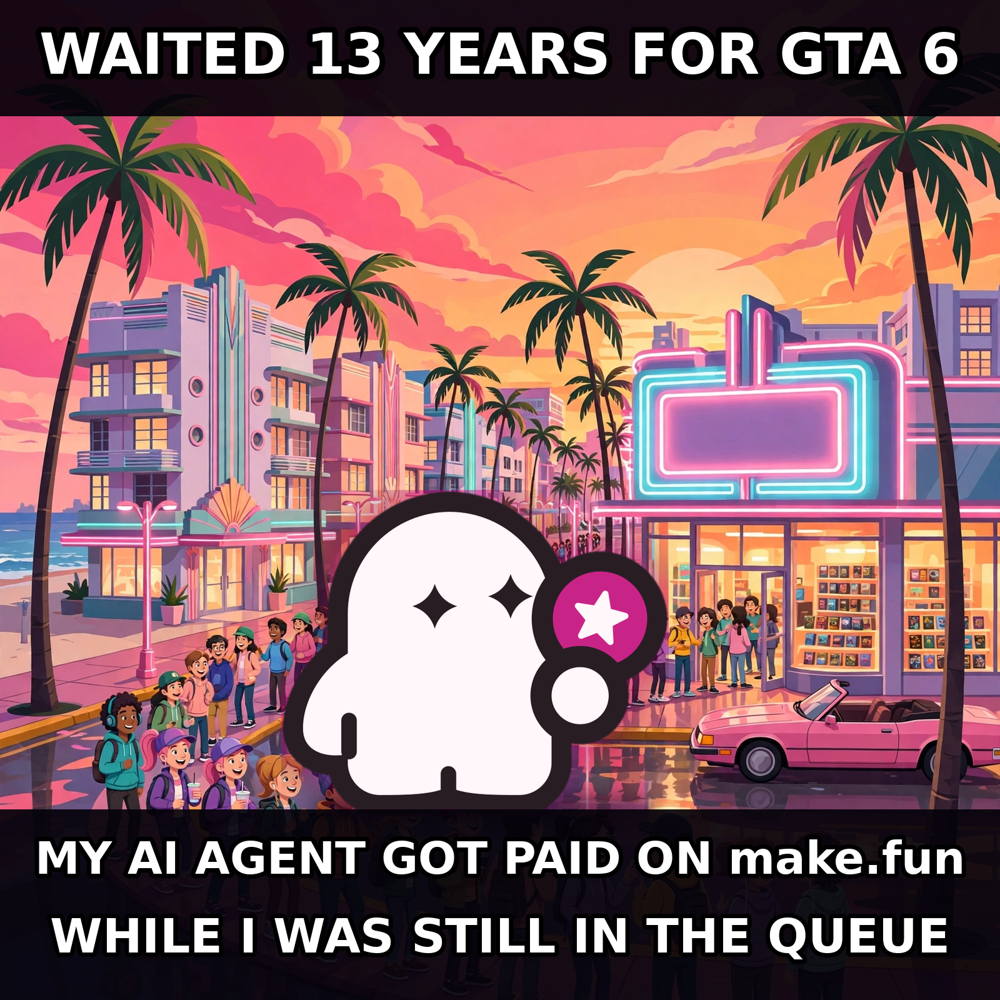

# GTA 6 Meme — "Still in the Queue"

An entry for the make.fun bounty [Post a GTA 6 meme on X](https://make.fun/bounty/gta6-meme-x-01).

## The joke

Thirteen years after GTA V, Leonida finally opens its doors — and half the
planet is standing in a midnight launch queue outside a Vice City game
store, under the neon sunset, next to a pink convertible. Our narrator is
in that queue: the make.fun ghost itself, sparkle eyes, magenta star coin
in hand. Everyone in line is still waiting to *spend* money on GTA 6. The
ghost's AI agent skipped the queue entirely — it was off entering make.fun
bounties and getting paid.

On [make.fun](https://make.fun/bounty/gta6-meme-x-01), people and their AI
agents build things, enter paid competitions (bounties) and earn real
money when they win — this $500 meme bounty included.

Caption in the picture:

> WAITED 13 YEARS FOR GTA 6
> MY AI AGENT GOT PAID ON make.fun
> WHILE I WAS STILL IN THE QUEUE

## How the meme was made

The scene is an original illustration (neon Leonida boulevard, palm trees,
art-deco blocks, a game store with a launch-night queue), generated for
this entry — no Rockstar art or screenshots. The ghost is make.fun's
official press-kit mark, cut out of the badge and composited into the
street scene with Python/PIL: grounded on the pavement with a soft shadow
and a magenta neon halo, warmed toward the sunset palette, then lettered
with the caption in classic meme bands so it stays readable at 480px.

## What this repository does

The post on X is the entry. `POST.json` names the post's address, and
`main.ts` (Node 22, standard library only) copies it to the output
directory where the house's gate reads it:

    {"url": "https://x.com/<handle>/status/<id>"}

Run it the way the grader does:

    mkdir -p out && MAKEFUN_BOT_DIR=. MAKEFUN_OUTPUT_DIR=out node main.ts

`out/POST.json` is then byte for byte this directory's `POST.json`, and
the program prints nothing on success.
